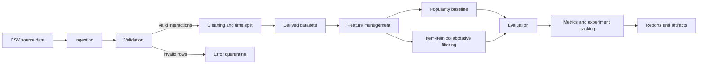

# Architecture

The Python orchestrator runs each stage in dependency order. CSV and JSON files keep intermediate outputs inspectable and portable. The feature layer is a set of versionable, reusable tables shared by training and inference.
